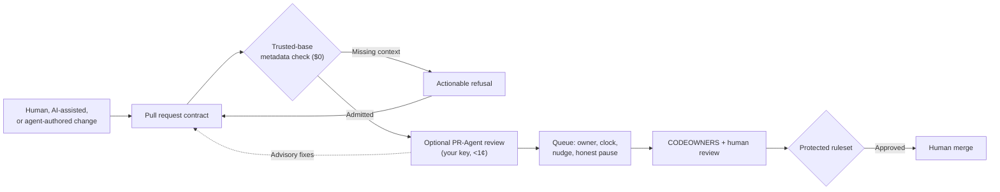

# Helicopter

Governance and intake for open source projects working with human, AI-assisted, and agent-authored contributions.

[](https://github.com/grosspoetrysystems/helicopter/actions/workflows/contribution-policy-tests.yml)
[](LICENSE)

AI can produce patches faster than maintainers can review them. More output does not mean more correct, useful, or trustworthy work. A generated change can pass syntax checks while missing the product intent, weakening a security boundary, or shifting review cost onto volunteers.

Helicopter gives maintainers a clear view of what a change does, how it was verified, what it risks, and queue pressure before they spend time on a patch. It keeps one person accountable for every contribution through a one-time sign-off, rejects incomplete submissions early, and leaves merge authority with humans.

## The problem

Most contribution processes assume a person performed the work and can explain it. Agentic workflows break that assumption:

- one operator can open many plausible pull requests;
- automated evidence may describe checks that were never run independently;
- agents can cross repository, network, secret, or tool boundaries;
- prompt injection and dependency substitution can target reviewers and CI; and
- maintainers still carry the cost of understanding, correcting, and supporting the result.

Projects need better intake without building an agent platform or turning every contribution into a compliance exercise.

## What Helicopter does

Helicopter adds a small policy layer to the normal GitHub pull request flow. Each pull request climbs a ramp: a cheaper step must pass before a more expensive one runs, and every step that stops it says why.

1. The contributor describes the change, how it was verified, and what it risks. Accountability is a one-time agreement: the DCO sign-off on commits.
2. A metadata-only check runs the validator from the protected default branch, at no cost.
3. Optionally, an admitted pull request gets a [PR-Agent](https://github.com/the-pr-agent/pr-agent) review on cheap inference with your own key (a fraction of a cent): what works, what to fix, effort, tests, and security.
4. The queue labels whose turn it is, nudges the owner after 7 days, and pauses publicly after 21 instead of going silent.
5. CODEOWNERS, project CI, rulesets, and human review handle the actual change.



The validator checks that the required sections are filled in. It does not decide whether a patch is correct or whether a claim is true.

## Who it considers

- **Maintainers:** bounded queues, early refusals, protected policy files, and less review spent on incomplete work.
- **Contributors:** one visible contract, specific repair instructions, and the same behavioral standard regardless of tool choice.
- **Security owners:** no untrusted code in privileged intake, minimum token permissions, immutable action pins, and optional verifiable disclosure.
- **Small projects:** plain Markdown, GitHub-native controls, a dependency-free validator, and no service to operate.

Helicopter moderates behavior and evidence. It does not ask maintainers to guess whether prose “looks AI-generated.”

## What is included

- `CONTRIBUTING.md`: Helicopter's contribution contract for humans and agents.
- `.github/pull_request_template.md`: change, verification, and risk.
- `.github/workflows/contribution-intake.yml`: trusted-base admission, the optional first review, and queue state.
- `.github/workflows/contribution-queue.yml`: keeps queue state current between pull request events.
- `.pr_agent.toml`: the first review's model and its input and output rules.
- `scripts/validate_pr.py`: dependency-free validation with actionable refusal codes.
- `scripts/pr_queue.py`: dependency-free queue.
- `.github/CODEOWNERS` and `MAINTAINERS.md`: ownership and repository settings.
- `SECURITY.md`, `CODE_OF_CONDUCT.md`, and focused issue forms.

Add an agent framework, provenance database, transcript storage, or policy DSL only when a real workflow needs it.

## Install with an agent

You need [Git](https://git-scm.com/downloads), Python 3.10 or newer, the [GitHub CLI](https://github.com/cli/cli#installation), and access to the target GitHub account:

```sh
gh auth login --web
gh auth status
```

Copy the prompt for the path you need.

### New repository

```text
Follow https://github.com/grosspoetrysystems/helicopter/blob/main/docs/start-new-repository.md
to configure this project:

- Name: <PROJECT_NAME>
- Purpose: <ONE_SENTENCE_PURPOSE>
- Language/runtime: <STACK>
- GitHub owner: <OWNER>
- Maintainer or team: <CODEOWNER>
- Private security contact: <CONTACT_OR_GITHUB_PRIVATE_REPORTING>
- Contribution agreement: <DCO_OR_CLA>
- Maintainer mode: <SOLO|CONTRIBUTOR|TEAM>
```

### Existing repository

```text
Follow https://github.com/grosspoetrysystems/helicopter/blob/main/docs/add-to-existing-repository.md
to install Helicopter in the current repository.

Maintainer mode: <SOLO|CONTRIBUTOR|TEAM>
```

The linked guides contain the implementation rules, verification steps, and mode configurator. Repository rulesets, required checks, private vulnerability reporting, interaction limits, and some security features require administrator access.

Choose [`solo`, `contributor`, or `team`](docs/maintainer-modes.md) for a sole maintainer, a maintainer-led contributor project, or an internal team that also accepts external contributions.

## Trust boundary

No privileged Helicopter job checks out, builds, or executes the contributor head. `contribution-intake.yml` uses `pull_request_target` so its workflow, scripts, and review rules load from the protected default branch and its jobs can comment on fork pull requests. Admission reads metadata with `contents: read`. The first review runs PR-Agent pinned by image digest; it holds the optional model key and a write token so it can post its review, and reads the pull request only through the API. The queue job holds `issues`/`pull-requests: write` and `checks: read` and no secret. A head checkout, build, test, or PR-controlled action does not belong in that workflow.

Project tests belong in a separate `pull_request` workflow on an ephemeral hosted runner with no secrets and minimum token permissions.

## Limits

Helicopter cannot prove that:

- the person who signed off reviewed or understands the patch;
- the contribution is correct, safe, licensed, useful, or in scope;
- a bot identity is authorized; or
- maintainers have capacity to review the work. The queue makes missing capacity visible; it cannot create it.

Rulesets, CODEOWNERS, independent CI, dependency and security checks, and human review remain the enforcement boundary.

## Contributing

Read [CONTRIBUTING.md](CONTRIBUTING.md) before opening an issue or pull request. Sign off your commits; the pull request needs only Change, Verification, and Risk.

## Security

Do not open public issues for vulnerabilities. Follow the private reporting instructions in [SECURITY.md](SECURITY.md).

## Design principles and references

Helicopter favors controls maintainers can inspect and enforce: accountable people, least-privilege automation, protected policy, independent CI, and human merge authority. These sources informed those choices:

- [GitHub Actions secure-use guidance](https://docs.github.com/en/actions/reference/security/secure-use): minimum token permissions, immutable action SHAs, protected workflows, and no privileged execution of untrusted code.
- [GitHub rulesets](https://docs.github.com/en/repositories/configuring-branches-and-merges-in-your-repository/managing-rulesets/about-rulesets): layered merge, review, and status-check controls.
- [GitHub interaction and pull-request limits](https://docs.github.com/en/communities/moderating-comments-and-conversations/limiting-interactions-in-your-repository): platform backpressure for public repositories.
- [OpenSSF's AI coding-assistant guidance](https://best.openssf.org/Security-Focused-Guide-for-AI-Code-Assistant-Instructions): developer responsibility and normal engineering controls still apply.
- [OpenSSF's OSS-CRS review](https://openssf.org/blog/2026/04/02/from-aixcc-to-openssf-welcoming-oss-crs-to-advance-ai-driven-open-source-security/): automated validation did not establish semantic correctness for many reviewed AI patches.
- [PyTorch's AI-assisted development guidance](https://github.com/pytorch/pytorch/blob/main/CONTRIBUTING.md#ai-assisted-development): contributors own the quality of their submissions, and new contributors start from a maintainer-triaged issue.
- [LLVM's AI tool-use policy](https://github.com/llvm/llvm-project/blob/main/llvm/docs/AIToolPolicy.md): contributors remain accountable, substantial tool use is disclosed, and autonomous participation requires explicit project approval.
- [Rust's LLM usage policy](https://forge.rust-lang.org/policies/llm-usage.html): AI review is not a substitute for required human review.
- [Developer Certificate of Origin 1.1](https://developercertificate.org/): a human or organization, not a model, makes the legal certification.

## License

Helicopter is released under the [MIT License](LICENSE).
